# qubit-calibration-sim

[](https://github.com/UBParker/qubit-calibration-sim/actions/workflows/tests.yml)

Single-transmon bring-up, from rough guesses to a calibrated qubit, on a simulated device. Each calibration node is laid out like Quantum Machines' open-source calibration library, [qua-libs `qualibration_graphs`](https://github.com/qua-platform/qua-libs/tree/main/qualibration_graphs/superconducting/calibrations/1Q_calibrations) [vendor]. QM's own nodes need a QOP server even in their simulate mode ([05_T1.py](https://github.com/qua-platform/qua-libs/blob/main/qualibration_graphs/superconducting/calibrations/1Q_calibrations/05_T1.py) [vendor]), so here a physics model with known true parameters stands in for the hardware and every result can be checked against a known answer. Each node is also written as a [QUA](https://docs.quantum-machines.co/1.2.2/docs/Introduction/qop_overview/) [vendor] program that builds and exports with QM's `qm-qua` SDK and passes the SDK's config schema check, but none has run on QM hardware or on QM's simulator.

Because the simulator knows the true device, it also makes small analysis details visible that are useful to know when running these nodes: 08a's trailing 5-point rolling mean places the readout pick about 0.2 MHz above the separation maximum, and 01a's success flag checks the ADC offsets but not the arrival edge, so a missing pulse still reports success ([notebook](notebooks/01a_time_of_flight_success_flag.ipynb); both under [Results](#results)).

Independent project, not affiliated with Quantum Machines.

<picture>
  <source media="(prefers-color-scheme: dark)" srcset="docs/media/bringup-convergence-dark.png">
  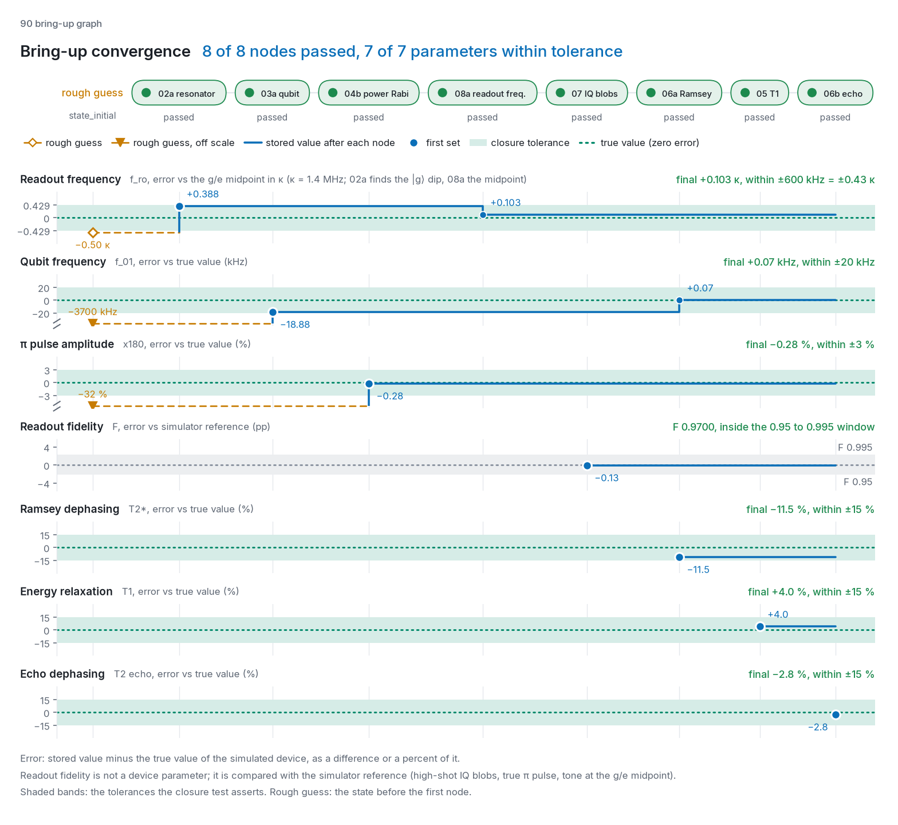
</picture>

Each row is one calibrated parameter's error against the simulated device's true value after each node of one run (seed 2026); shaded bands are the closure-test tolerances, listed under [Tests](#tests).

**Power Rabi on the Bloch sphere.** The same 40 ns, σ = 8 ns Gaussian pulse from |g> in the three-level Lindblad simulation: the 0.1 V starting amplitude from `state_initial.json` under-rotates (left), and the device's true pi amplitude of 147.14 mV lands on |e> (right). The populations printed under each sphere are simulated values.

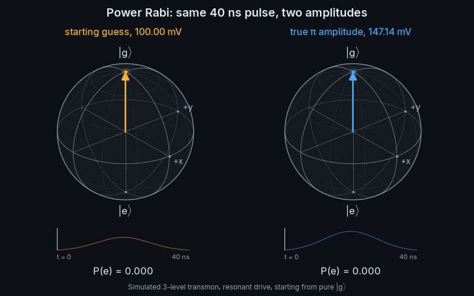

## Run it

```
uv sync --locked
uv run python -m calibrations.90_calibration_graph_bringup   # the 01a setup step, then the graph
uv run python -m viz.build_all   # the same run, then every figure and GIF in docs/media
```

The bring-up with seed 2026 prints:

```
01a_time_of_flight SUCCESS: time of flight to add 212 ns, offsets to add I 1.109 mV, Q -0.999 mV
02a_resonator_spectroscopy SUCCESS: f_res = 7.041244 GHz +/- 4.4 kHz, dip FWHM = 1.46 MHz, kappa (notch fit) = 1.816 +/- 0.016 MHz, notch depth = 0.631, SNR = 49
03a_qubit_spectroscopy SUCCESS: f_01 = 5.123681 GHz +/- 11.3 kHz, FWHM = 555 kHz
04b_power_rabi SUCCESS: x180 amplitude = 146.73 +/- 0.40 mV statistical (x1.467), SNR 10.2, phase error 0.02 rad, 0.99 periods, refined from 147.25 mV (0.68 periods)
08a_readout_frequency_optimization SUCCESS: readout detuning -0.400 MHz, chi -0.550 MHz
07_iq_blobs SUCCESS: IW angle = -113.7 deg, threshold = 1.518 mV, fidelity = 97.0 % (gg 0.978, ge 0.022, eg 0.038, ee 0.962)
06a_ramsey SUCCESS: detuning to correct = -18.9 +/- 0.1 kHz, T2* = 27.4 +/- 0.6 us
05_T1 SUCCESS: T1 = 49.9 +/- 1.9 us
06b_echo SUCCESS: T2echo = 60.3 +/- 2.3 us
8/8 nodes succeeded.
```

`viz.build_all` rebuilds every file in `docs/media` from the seed-2026 run and fails if the total goes over 15 MB. On the machine that rendered the committed media (macOS on Apple silicon), Python 3.11 (the CI version) with the locked dependencies reproduces them, `state.json` and the QUA exports byte for byte. Python 3.12 on the same machine changes floats in about the tenth significant digit, so `state.json`, the QUA exports and some node PNGs differ in bytes though not in any printed number. Other platforms have not been checked, and no test compares rebuilt media with the committed files.

## Why simulate

QM's own calibration nodes can't run without a controller: even their `simulate` mode connects to a QOP server ([05_T1.py](https://github.com/qua-platform/qua-libs/blob/main/qualibration_graphs/superconducting/calibrations/1Q_calibrations/05_T1.py) [vendor], where `simulate_qua_program` calls `node.machine.connect()` first; the library [README](https://github.com/qua-platform/qua-libs/blob/main/qualibration_graphs/README.md) [vendor] also lists QOP hardware access as a prerequisite for running on hardware). This repo replaces the hardware with a physics model, so the full loop of program, data, fit and state update runs without a controller, and every result can be checked against a known answer.

## How it maps onto QUAlibrate

| This repo | QUAlibrate / qua-libs | Finds | Updates |
|---|---|---|---|
| `01a_time_of_flight` (setup step) | `01a_time_of_flight` | time of flight and ADC offsets | `resonator.time_of_flight`, `opx_input_I/Q.offset` |
| `02a_resonator_spectroscopy` | `02a_resonator_spectroscopy` | readout resonator frequency | `resonator.f_01` |
| `03a_qubit_spectroscopy` | `03a_qubit_spectroscopy` | qubit frequency (saturation spectroscopy) | `qubit.f_01` |
| `04b_power_rabi` | `04b_power_rabi` | pi-pulse amplitude | `x180.amplitude` |
| `08a_readout_frequency_optimization` | `08a_readout_frequency_optimization` | readout frequency maximising g/e separation, χ | `resonator.f_01`, `qubit.chi` |
| `07_iq_blobs` | `07_iq_blobs` | readout rotation, threshold, assignment fidelity | `integration_weights_angle`, `threshold`, `readout_fidelity` |
| `06a_ramsey` | `06a_ramsey` | T2*, residual frequency error (± detuning for the sign) | `qubit.T2ramsey`, `qubit.f_01` |
| `05_T1` | `05_T1` | energy relaxation | `qubit.T1` |
| `06b_echo` | `06b_echo` | Hahn-echo coherence | `qubit.T2echo` |
| `90_calibration_graph_bringup` | `90_calibration_graph_bringup_fixed_frequency_transmon` | runs 01a, then the other eight in QM's order, stops at the first failure | everything |

What carries over from QM's design:

- **Node layout.** Each node has a description with prerequisites and the state it updates, a `Parameters` class, a QUA program, an execution step, analysis, plotting and a state update that runs only when the fit succeeds.
- **State.** `state.json` plays the role of [QUAM](https://github.com/qua-platform/quam) [vendor]: every node reads it and writes back what it calibrated. The rough starting point lives in `state_initial.json`. `qua/config.py` builds the QM configuration dictionary from the state, as `machine.generate_config()` does, and the config passes the schema validation in QM's `qm-qua` SDK, run offline (`tests/test_qua_programs.py`).
- **QM's analysis code.** Fits use [qualibration-libs](https://github.com/qua-platform/qualibration-libs) [vendor], the library QM's nodes call: `fit_decay_exp` (T1, echo), `fit_oscillation` (Rabi), `fit_oscillation_decay_exp` (Ramsey), `peaks_dips` (spectroscopy). The IQ blob discriminator is `two_state_discriminator` from [py-qua-tools](https://github.com/qua-platform/py-qua-tools) [vendor]. Where qualibration-libs has a model but no fitting routine (the Lorentzians), the node fits QM's model with `scipy` and says so in the code.
- **Graph order.** It matches QM's fixed-frequency bring-up graph ([90_calibration_graph_bringup_fixed_frequency_transmon.py](https://github.com/qua-platform/qua-libs/blob/main/qualibration_graphs/superconducting/calibrations/1Q_calibrations/90_calibration_graph_bringup_fixed_frequency_transmon.py) [vendor]), limited to the nodes implemented here; QM's graph also runs 04a, 08b, two error-amplified power Rabi passes, 10b and 11a. QM numbers 01a time of flight first but leaves it out of that graph, as a setup step; here it runs once before the graph, from QM's 24 ns default in `state_initial.json`.

`qua/programs/` holds every node's QUA program exported with `qm.generate_qua_script`, configuration included. They are exported as text; no QM compiler, simulator or controller has run them. QUA is QM's pulse-level language, written in Python, compiled to run on the FPGA-based pulse processor inside the OPX ([QOP overview, QM docs](https://docs.quantum-machines.co/1.2.2/docs/Introduction/qop_overview/) [vendor]).

## Results

One run of the bring-up graph (seed 2026), starting 3.7 MHz off on the qubit, 1.25 MHz off on the resonator (against the |g> dip that 02a finds; the hero's readout row measures from the g/e midpoint, where the same guess is 0.70 MHz or 0.50 κ low), 32% low on the pi amplitude and 213 ns early on the time of flight. Open a node for its figure and notes.

<details>
<summary><b>Time of flight (setup step)</b>: 236 ns against a true 237 ns; ADC offsets within 0.2 mV</summary>

<picture>
  <source media="(prefers-color-scheme: dark)" srcset="docs/media/01a_time_of_flight-dark.png">
  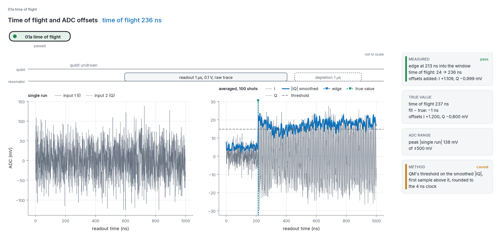
</picture>

The raw ADC trace of a 1 µs, 0.1 V readout pulse, averaged over 100 shots, with QM's edge detector: |IQ| smoothed by a Savitzky-Golay filter (window 11, order 3; [Savitzky & Golay 1964](https://doi.org/10.1021/ac60214a047)), a threshold at the average of two overlapping means of the smoothed trace (from sample 100 to the end, and from the start to 100 samples before the end), which lands close to the whole-trace mean and so about as far up the step as the fraction of the window the pulse fills (0.81 of the way on a simulated 0.1 V trace), and the first sample above it, rounded to the 4 ns clock ([QM 01a analysis](https://github.com/qua-platform/qua-libs/blob/main/qualibration_graphs/superconducting/calibration_utils/time_of_flight/analysis.py) [vendor]). The edge sits 213 ns into a window that opened at 24 ns, so the time of flight becomes 236 ns against a true 237 ns; the ADC offsets come out within 0.2 mV of the true +1.2 and -0.8 mV. QM's success flag requires both ADC offsets inside the ±0.5 V input range and the delay and offsets not all NaN; it does not test the edge itself, so a trace with no pulse in it also reports success, a result that does not depend on this simulator ([notebook](notebooks/01a_time_of_flight_success_flag.ipynb), section 2). QM's code default amplitude is 0.03 V, and its docstring gives 0.1 V ([QM 01a parameters](https://github.com/qua-platform/qua-libs/blob/main/qualibration_graphs/superconducting/calibration_utils/time_of_flight/parameters.py) [vendor]). At this simulator's assumed ADC noise (38 mV rms per 1 ns sample and input, not measured on hardware), 0.03 V with 100 averages stored a time of flight more than 4 ns from the true value, with the success flag set, in 50 of 50 seeds (0 to 49; `tests/test_01a_time_of_flight.py`, marked `slow`); at half that noise it did so in 3 of 30 seeds and at twice that noise in 30 of 30 (notebook, section 4), so how 0.03 V does on hardware depends on the setup's signal-to-noise ratio. The node here uses 0.1 V. The notebook also sketches an edge-step check (a suggestion, not QM's code). Over 200 seeds the stored value is 236 ns (74 runs) or 240 ns (126).

</details>

<details>
<summary><b>Resonator spectroscopy</b>: f_res 1.24 MHz above the starting guess; κ 1.816 ± 0.016 MHz against a true 1.4 MHz, read high by the resonator ring-up</summary>

<picture>
  <source media="(prefers-color-scheme: dark)" srcset="docs/media/02a_resonator_spectroscopy-dark.png">
  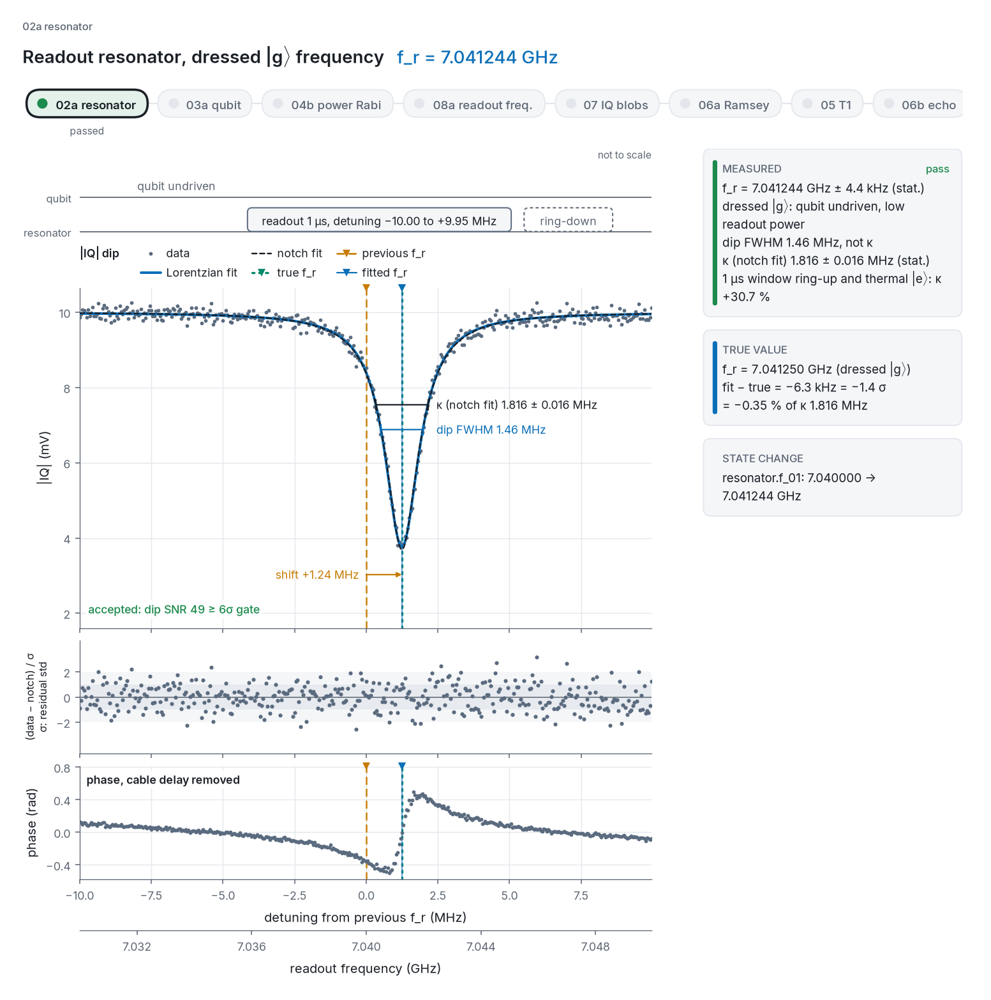
</picture>

The notch dip in |IQ| with Lorentzian and notch fits, and the phase roll with the cable delay removed; the fitted resonator sits 1.24 MHz above the starting guess. The dip FWHM (1.46 MHz) is reported apart from κ, which comes from the notch-type model of [Probst et al. 2015](https://doi.org/10.1063/1.4907935): 1.816 ± 0.016 MHz against a true 1.4 MHz. The model is a steady state, while the resonator rings up inside the 1 µs window, so every point is the window average of a field that starts empty; noise-free, that reads κ 30.7 % high at 1 µs and 7 % high at 4 µs. The bias is reported, pinned in a test and printed on the figure, not corrected.

</details>

<details>
<summary><b>Qubit spectroscopy</b>: f_01 found 3.68 MHz above the starting guess, on a 555 kHz power-broadened line</summary>

<picture>
  <source media="(prefers-color-scheme: dark)" srcset="docs/media/03a_qubit_spectroscopy-dark.png">
  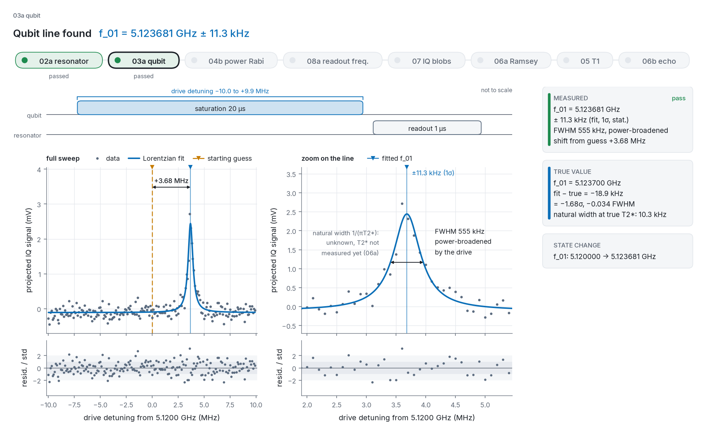
</picture>

A full sweep and a zoom on the saturated line, found 3.68 MHz above the starting guess. Its 555 kHz FWHM is broadened by the drive power ([Schuster et al. 2005](https://doi.org/10.1103/PhysRevLett.94.123602)), far wider than the figure's exponential-decay estimate, 1/(π T2*) = 10.3 kHz at the true T2*. This simulator's zero-drive line is instead the convolution of a 1/(π T2echo) Lorentzian (5.1 kHz FWHM) with the 5.1 kHz rms Gaussian of the quasi-static frequency offset, a Voigt profile of about 15 kHz FWHM ([Olivero & Longbothum 1977](https://doi.org/10.1016/0022-4073(77)90161-3) give the width formula). The line shape is a steady-state approximation (see Simplifications).

</details>

<details>
<summary><b>Power Rabi</b>: pi amplitude 146.73 ± 0.40 mV, -0.28% from the true value, after one refine pass</summary>

<picture>
  <source media="(prefers-color-scheme: dark)" srcset="docs/media/04b_power_rabi-dark.png">
  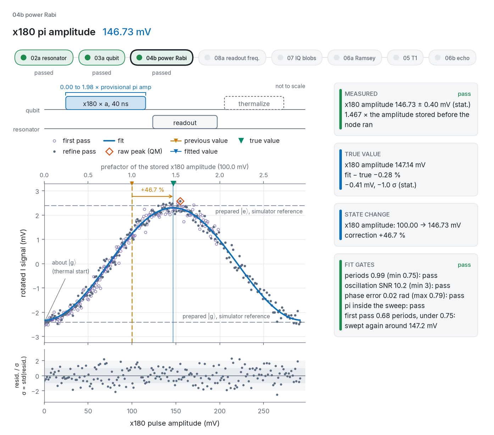
</picture>

Both passes of the amplitude sweep: the first covers only 0.68 periods, below the 0.75-period gate, so the refine pass recentres on 147.25 mV. The pi amplitude, 146.73 ± 0.40 mV (-0.28% from the true value), comes from the fitted phase and frequency, and the side panel lists each fit gate with its result.

</details>

<details>
<summary><b>Readout frequency optimization</b>: readout moved 0.40 MHz down, to 144 kHz above the g/e midpoint; χ = -0.55 ± 0.05 MHz in QM's sign</summary>

<picture>
  <source media="(prefers-color-scheme: dark)" srcset="docs/media/08a_readout_frequency_optimization-dark.png">
  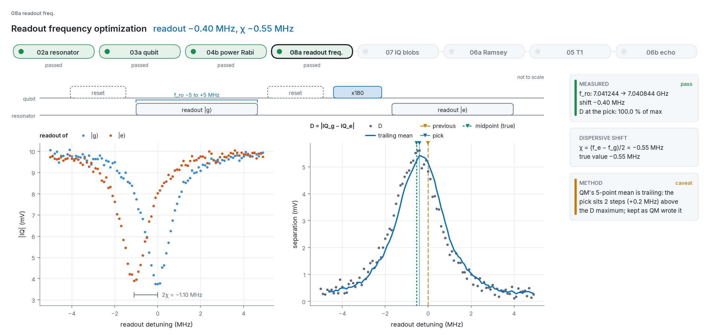
</picture>

Averaged I/Q after |g> and after an x180, across ±5 MHz of readout frequency. The two dips sit 2χ apart (χ = -0.55 MHz in QM's sign, (f_e - f_g)/2, from the two dips on the 0.1 MHz grid, so resolved to ±0.05 MHz), and the separation D between the two averaged points peaks at their midpoint. QM's analysis takes the argmax of a 5-point `rolling` mean of D, which xarray computes trailing by default, so on a smooth peak the pick sits 2 steps (0.2 MHz) above the maximum of D ([QM 08a analysis](https://github.com/qua-platform/qua-libs/blob/main/qualibration_graphs/superconducting/calibration_utils/readout_frequency_optimization/analysis.py) [vendor]). The node uses QM's analysis as published and a test pins the offset: over 300 seeds the pick sits +201 kHz above the true midpoint on average (sd 93 kHz). Here the readout moves 0.40 MHz down, to 144 kHz above the midpoint; at the closure band edge (±600 kHz) the separation is still 0.85 of its maximum, and 07's fidelity at the pick is 0.005 to 0.011 higher than at the |g> dip on seeds 1 to 3.

</details>

<details>
<summary><b>IQ blobs</b>: assignment fidelity 97.0% as (gg + ee)/2, with an error budget for each misassignment</summary>

<picture>
  <source media="(prefers-color-scheme: dark)" srcset="docs/media/07_iq_blobs-dark.png">
  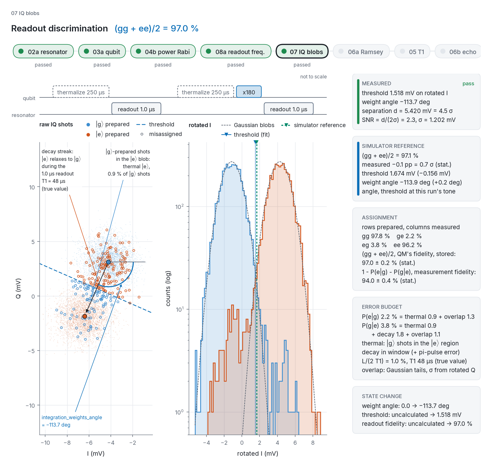
</picture>

Single shots in the IQ plane, with a streak of |e> shots relaxing to |g> during the 1 µs readout, and rotated-I histograms with the fitted threshold next to the simulator reference. The side panels give the confusion matrix, both fidelity definitions ((gg + ee)/2 = 97.0%, which py-qua-tools' [`two_state_discriminator`](https://github.com/qua-platform/py-qua-tools/blob/main/qualang_tools/analysis/discriminator.py) [vendor] returns and the node stores, and 1 - P(e|g) - P(g|e) = 94.0%), and an error budget splitting each misassignment into thermal population, decay in the readout window and Gaussian overlap.

</details>

<details>
<summary><b>Ramsey</b>: ±300 kHz fringes move f_01 up 18.95 kHz; T2* = 27.4 ± 0.6 µs, 11.5% below the true 31 µs, mostly fit-model bias (9.1% noise-free)</summary>

<picture>
  <source media="(prefers-color-scheme: dark)" srcset="docs/media/06a_ramsey-dark.png">
  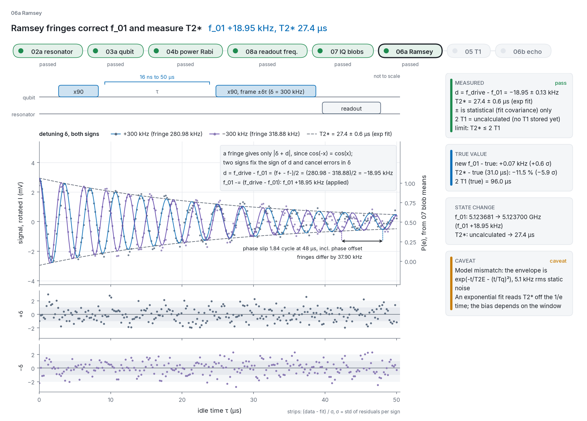
</picture>

Fringes at +300 kHz and -300 kHz virtual detuning (frame rotation) overlaid ([Ramsey 1950](https://doi.org/10.1103/PhysRev.78.695)). With δ = ±300 kHz the virtual detuning, one fringe gives only |δ + d|, so the sign comes from both: d = (f+ - f-)/2 = (280.98 - 318.88)/2 = -18.95 kHz, which the node corrects by moving f_01 up 18.95 kHz. The shared envelope gives T2* = 27.4 ± 0.6 µs, 11.5 % below the true 31 µs: the fit's exponential envelope cannot follow the device's Gaussian component (see Simplifications).

</details>

<details>
<summary><b>T1</b>: 49.9 ± 1.9 µs, +4.0% from the true 48 µs</summary>

<picture>
  <source media="(prefers-color-scheme: dark)" srcset="docs/media/05_T1-dark.png">
  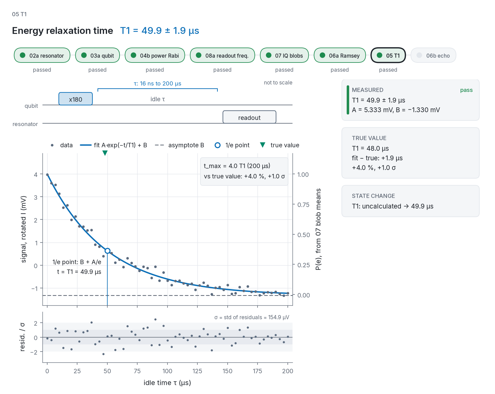
</picture>

Decay after an x180, with the 1/e point marked at T1 = 49.9 ± 1.9 µs (+4.0% from the true 48 µs); the sweep reaches 4.0 T1.

</details>

<details>
<summary><b>Hahn echo</b>: T2echo = 60.3 ± 2.3 µs, -2.8% from the true 62 µs</summary>

<picture>
  <source media="(prefers-color-scheme: dark)" srcset="docs/media/06b_echo-dark.png">
  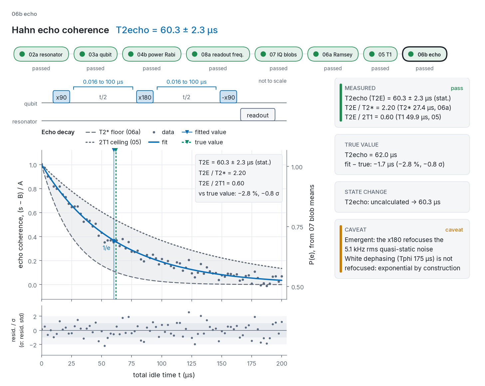
</picture>

The x90, x180, -x90 echo decay ([Hahn 1950](https://doi.org/10.1103/PhysRev.80.580)) between the T2* floor from 06a and the 2 T1 ceiling from 05, the bound T2 ≤ 2 T1 ([Krantz et al. 2019](https://doi.org/10.1063/1.5089550)); T2echo = 60.3 ± 2.3 µs, -2.8% from the true 62 µs. The gain over T2* is emergent: the x180 refocuses the device's quasi-static frequency noise, and the caveat panel notes that the remaining white dephasing makes this decay exponential by construction.

</details>

## What the simulator lets you see

The simulator holds the full qubit state, so it can show what a real experiment only infers from averaged readout. The power Rabi animation is at the top of this page.

<details>
<summary><b>Ramsey on the Bloch sphere</b>: precession at 300 kHz detuning, shrinking with dephasing</summary>

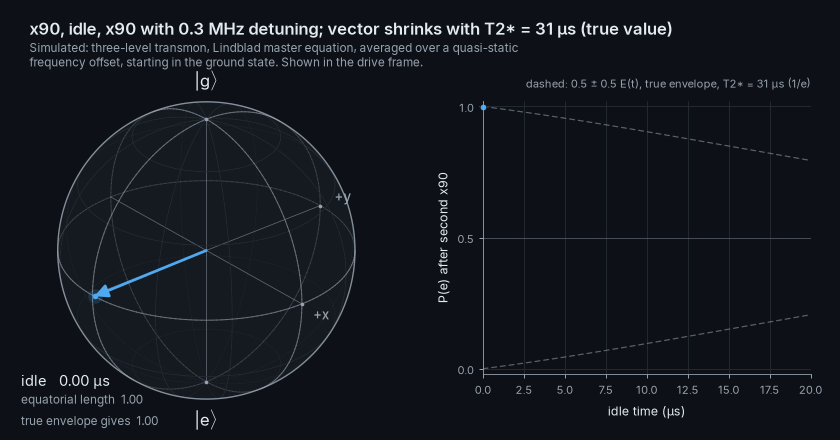

An x90 takes the state to -y, it precesses about z at the 300 kHz drive detuning for up to 20 µs while dephasing shrinks it, and a second x90 maps y onto the excited population that 06a fits. Every vector and fringe point is simulated, as the average over the quasi-static frequency offset; only the faint curve is analytic, the true envelope exp(-t/T2E - (t/Tq)²), whose 1/e time is the device's T2* of 31 µs.

</details>

<details>
<summary><b>Hahn echo</b>: an illustration of refocusing, not a simulator run</summary>

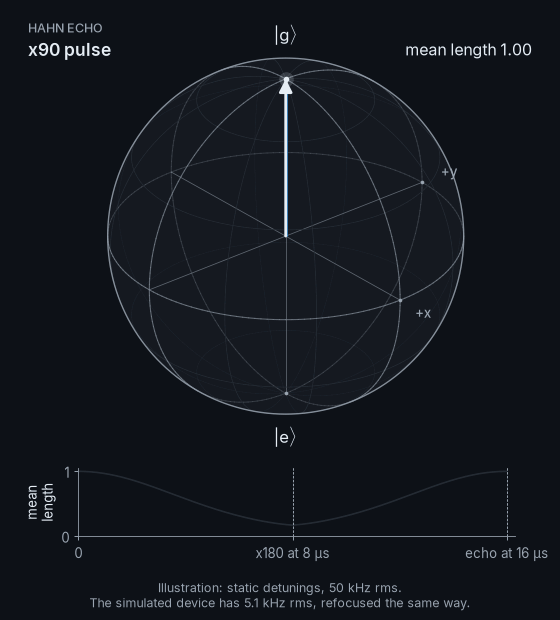

An illustration, not a simulator run: 24 spins with static detunings (50 kHz spread) fan out after an x90, an x180 flips them, and they refocus at 2τ ([Hahn 1950](https://doi.org/10.1103/PhysRev.80.580)). The spread is about ten times the simulated device's 5.1 kHz rms so the fan-out is visible; the simulator's 06b echo refocuses the same kind of noise.

</details>

<details>
<summary><b>Pulse leakage</b>: a 10 ns pi pulse leaves about 6,500 times more population in the f level than a 40 ns one</summary>

<picture>
  <source media="(prefers-color-scheme: dark)" srcset="docs/media/leakage-dark.png">
  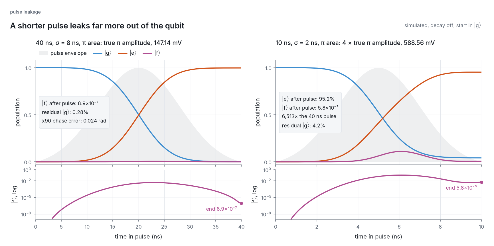
</picture>

Populations of |g>, |e> and |f> through the 40 ns pi pulse at the device's true pi amplitude (147.14 mV) and a 10 ns pulse of the same area, with decay off. The 40 ns pulse leaves 8.9×10⁻⁷ in |f>; the 10 ns one leaves 5.8×10⁻³ (about 6,500 times more) and reaches only 95.2% in |e>, with 4.2% left in |g> because the |f> level shifts the qubit line during the short pulse. DRAG is designed to correct both the leakage and that phase error ([Motzoi et al. 2009](https://doi.org/10.1103/PhysRevLett.103.110501)).

</details>

## The simulated device

`simulator/` holds a hidden "true" device (`simulator/device.py`). Calibration code only ever sees noisy I/Q from `SimulatedQPU`.

- **Qubit.** A transmon is a weakly anharmonic oscillator with negative anharmonicity ([Koch et al. 2007](https://doi.org/10.1103/PhysRevA.76.042319)). It is modelled with three levels so pulses can leak to |f>, evolved with [QuTiP](https://qutip.org/) [software]'s Lindblad master equation ([Lindblad 1976](https://doi.org/10.1007/BF01608499); QuTiP 5: [Lambert et al. 2026](https://doi.org/10.1016/j.physrep.2025.10.001)) in the frame of the drive. Decay and dephasing come from collapse operators set by T1 and the pure dephasing time Tphi, using 1/T2 = 1/(2 T1) + 1/Tphi ([Krantz et al. 2019](https://doi.org/10.1063/1.5089550)) for the Markovian T2, which here is T2echo. Each shot also gets a static qubit frequency offset drawn from a Gaussian of 5.1 kHz rms, averaged over shots by Gauss-Hermite quadrature; slow noise in the static limit gives a Gaussian Ramsey decay that an echo refocuses ([Ithier et al. 2005](https://doi.org/10.1103/PhysRevB.72.134519)).
- **Readout.** Dispersive: the resonator frequency depends on the qubit state ([Blais et al. 2021](https://doi.org/10.1103/RevModPhys.93.025005)); the |g> and |e> resonator frequencies differ by 2χ. The readout runs in the time domain (`simulator/readout.py`), solved in closed form per shot:
  - Ring-up: the intracavity field follows the input-output equation of [Gardiner & Collett 1985](https://doi.org/10.1103/PhysRevA.31.3761) for a notch resonator, starting empty at the pulse edge, so a 1 µs readout averages a field that is still ringing up; its steady state is the notch transmission of [Probst et al. 2015](https://doi.org/10.1063/1.4907935). If |e> decays during the window, the field switches to the |g> frequency at that moment.
  - Time of flight: the signal reaches the ADC 237 ns after the pulse starts. The ADC window opens at the state's `time_of_flight`, so a wrong value cuts off part of the signal and turns its phase.
  - ADC offset and noise: each analog input adds a fixed offset (+1.2 mV on I, -0.8 mV on Q) and white Gaussian noise on every 1 ns sample.
  - Demodulation: the window is demodulated as QUA's `dual_demod.full` does ([QM demodulation guide](https://docs.quantum-machines.co/latest/docs/Guides/demod/) [vendor]), with the integration weights and rotation angle from the state's config. Readout-noise levels follow from the per-sample noise, not from a separate setting.
- **True values.** f_01 = 5.1237 GHz, anharmonicity = -212 MHz, f_res = 7.04125 GHz (the |g> dip, f_res_g), χ = 0.55 MHz (f_res_e = f_res_g - 2χ; 08a reports -0.55 MHz in QM's (f_e - f_g)/2 sign), kappa = 1.4 MHz, time of flight = 237 ns, ADC offsets = +1.2 mV (I) and -0.8 mV (Q), T1 = 48 us, T2* = 31 us (1/e time of the shot-averaged Ramsey envelope), T2echo = 62 us (Markovian; quasi-static noise 5.1 kHz rms), thermal |e> population 1.2%.

### Simplifications, stated plainly

- **Low-frequency noise is quasi-static only.** Each shot sees a fixed frequency offset (5.1 kHz rms) plus white Lindblad dephasing. The echo refocuses the offset completely, so its decay is exponential by construction; real 1/f noise has power at frequencies the echo does not cancel and makes the echo decay non-exponential as well ([Bylander et al. 2011](https://doi.org/10.1038/nphys1994)). The Ramsey envelope is exp(-t/T2E - (t/Tq)²), which QM's exponential fit does not model. Noise-free, the 06a fit over its 50 µs window returns T2* = 28.17 µs, 9.1 % below the envelope's 1/e time of 31 µs; over 31 seeded bring-ups (seeds 0 to 29 and 2026) the mean is -8.6 % (range -12.1 % to -5.5 %). With a 25 µs window the same fit reads 15.5 % high, so the sign of the bias depends on the sweep.
- **Qubit spectroscopy** uses the steady-state solution of the Bloch equations ([Bloch 1946](https://doi.org/10.1103/PhysRev.70.460)). Its power-broadened half width, sqrt(1/T2^2 + Omega^2 T1/T2) with the Markovian T2 = T2echo, is the dependence [Schuster et al. 2005](https://doi.org/10.1103/PhysRevLett.94.123602) measured on a Cooper pair box qubit. Steady state is an approximation here: the driven qubit's transient decays with a 1/e time constant of 2/(1/T1 + 1/T2), about 54 us under strong drive ([Torrey 1949](https://doi.org/10.1103/PhysRev.76.1059)), longer than the 20 us saturation pulse the QUA program plays. A two-level Bloch estimate (2 mV drive, T2 = 62 us, thermal start) puts P(e) at 0.77 after the 20 us pulse at 100 kHz detuning, against 0.46 in steady state, so a real line would be distorted, with its maximum away from zero detuning. The QUA consistency check lists this as `saturation_steady_state` in `calibration_utils/qua_bridge.py`. The |f> level and the AC Stark shift it causes are left out of this model.
- **Relaxation** goes to |g>, not back to the thermal population.
- **Pulses** are plain Gaussians with no DRAG correction ([Motzoi et al. 2009](https://doi.org/10.1103/PhysRevLett.103.110501)). In this simulator, with decay switched off, leakage to |f> after a 40 ns pi pulse is 8.9×10⁻⁷, but the |f> level still shifts |e> during the pulse: the pi pulse leaves 0.28% in |g> and an x90 picks up a 0.024 rad phase error. DRAG would correct both; it is listed under Future work.
- **Power Rabi refine pass.** QUA limits a pulse amplitude scale factor to -2 to 2 - 2^-16 (the `amp()` range in the [QUA API reference](https://docs.quantum-machines.co/1.4.1/docs/API_references/qua/dsl_main/) [vendor]; this repo applies the same limit to `amplitude_scale`), so from the 0.1 V starting guess the 04b sweep covers only 0.68 Rabi periods. Like QM's analysis, the fit is rejected below 0.75 periods ([QM power_rabi analysis.py](https://github.com/qua-platform/qua-libs/blob/main/qualibration_graphs/superconducting/calibration_utils/power_rabi/analysis.py) [vendor]); QM's node stops there and leaves recentring the sweep to the user ([QM 04b node](https://github.com/qua-platform/qua-libs/blob/main/qualibration_graphs/superconducting/calibrations/1Q_calibrations/04b_power_rabi.py) [vendor]), while this repo's node (our choice, not QM behaviour) runs one more sweep centred on the provisional pi amplitude and updates the state from that second fit.
- **The readout model is linear.** It leaves out resonator nonlinearity (Kerr), the photon-number dependence of the dispersive shift and the breakdown of the dispersive approximation at high photon number, measurement-induced state transitions, measurement-induced dephasing and the AC Stark shift of the qubit during readout, Purcell filtering, amplifier bandwidth and the ADC anti-aliasing filter (the edge at the ADC is instantaneous), and residual photons from a previous measurement (every readout starts with an empty resonator). Readout power optimization (08b) would therefore always pick the largest amplitude, so it is not implemented.
- **The controller is otherwise ideal.** No mixer imbalance or line distortions, so QM's mixer calibration (`01a_mixer_calibration`) is not implemented. Time of flight and ADC offsets are modelled, and 01a calibrates them.
- **The QUA programs do not drive the simulator.** Each node calls the simulator directly with the sweep its QUA program describes; a per-node check (see Tests) keeps the two in step, but no QUA program is executed.

## Tests

`uv run pytest` runs the 425 default tests in about 60 s; `uv run pytest -m "slow or not slow"` runs all 567 in about 7 minutes (566 pass and 1 is a documented strict xfail), including the 30-seed bring-up run, the realistic-noise scenarios and the render and GIF-size checks marked `slow`, and CI runs all of them. They are closure tests: the simulator knows the answer, so every node is checked against it.

- **Per-node closure.** From a state where only that node's parameter is wrong, the fit must recover the true value within a stated tolerance across two to five fixed seeds. Examples: resonator within kappa/10, pi amplitude within 2%, T1 within 10%, Ramsey frequency correction within 20 kHz for ±150 kHz injected errors. Where the device departs from the fit model (the non-exponential Ramsey envelope, the κ ring-up bias), a test pins the size of the bias instead of hiding it in the tolerance.
- **Failure handling.** A failed fit must leave the state untouched, and nodes must report failure when there is nothing to find. Examples: a resonator guess 30 MHz off, or a drive 300 MHz detuned.
- **End to end.** From `state_initial.json` the full graph must succeed and land on the true device within `CLOSURE_TOLERANCES` (`simulator/reference.py`), the bands drawn in the convergence figure: ±600 kHz (0.43 κ) on the readout frequency against the g/e midpoint f_res_g - χ, which 08a aims for (QM's trailing mean puts its pick about 200 kHz above it on average, see the 08a result), ±20 kHz on f_01, ±3% on the pi amplitude, ±15% on T2*, T1 and T2echo, and an absolute 0.95 to 0.995 window on the stored readout fidelity, which is not a device parameter and is plotted against the simulator reference. The same test asserts χ within 150 kHz and the 01a time of flight and ADC offsets within 4 ns and 0.5 mV, which have no figure row. The T2* row does not test the simulator against its own model: the exponential fit lands about 9 % low on the non-exponential envelope (see Simplifications), and the 15% band absorbs that.
- **QUA.** Every program builds and exports with `qm-qua`, and the generated config passes the SDK's schema validation offline. No program is compiled or run by QM software or hardware.
- **QUA program and simulation agree.** A per-node check walks each QUA program's protobuf and asserts the simulator is asked to run the same sweep, pulses, waits and readout; what the simulator knowingly ignores is listed in `calibration_utils/qua_bridge.py` (`SIMULATOR_APPROXIMATIONS`).

<details>
<summary><b>Realistic bad data</b>: seeded noise channels every node must survive or reject, with two known blind spots</summary>

Optional, seeded noise channels on the simulated QPU (slow frequency drift, a coupled two-level defect, readout glitches and quasiparticle bursts, drive amplitude drift; `simulator/noise.py`, off by default) feed every node data of the kind real bring-ups produce. Each node must return the right answer or reject with a named gate, never a confident wrong answer (`tests/test_realistic_noise.py`), with the exceptions below.

Averaged readout uses the bare device T1 inside the readout window: a TLS or a burst changes the populations before the readout, not the decay during it (single shots include both). Under drift the right answer is the run-mean frequency and that run's effective T2*: the shot loop sits outside the sweep loop, as in QM's programs, so a drift slower than one sweep pass reaches every point alike and acts as extra low-frequency noise.

Known blind spots: one quasiparticle burst during the 05 T1 run shifts T1 by up to 11.5 % (seeds 0 to 30) and no gate flags it, because its residuals look like clean ones (Durbin-Watson 1.64 to 2.66 against 1.39 to 2.61). A random-walk frequency drift on 06a seed 1 of 3 (a strict xfail) gives Durbin-Watson 1.25, which passes the 1.2 gate, and the frequency lands 2.33 kHz from the run mean against a 2 kHz limit. A TLS-limited T1 of a few µs falls within one or two points of the default 05 sweep and is rejected as under-sampled rather than measured.

</details>

## Layout

```
calibrations/        one file per node, numbered like qua-libs; 90_ is the graph
calibration_utils/   per-node analysis and plotting, plus shared plumbing (common.py)
simulator/           device truth, 3-level transmon dynamics, readout and QPU interface
qua/                 config builder, QUA macros, exported programs
viz/                 Bloch-sphere animations, leakage figure, convergence hero, build_all
docs/media/          README figures (light and dark) and GIFs, written by build_all
state_initial.json   rough guesses before bring-up
state.json           latest calibrated state
tests/               closure, failure, end-to-end and QUA tests
notebooks/           executed notebooks on single analysis details (01a success flag)
```

## Future work

Not done yet, each with what it would show:

- **QUA programs drive the simulator.** Execute each node's QUA program against the simulated QPU instead of calling the simulator directly, migrate every node to that path, and simulate the finite 03a saturation pulse; this would show the 03a line shape the 20 µs pulse really gives (P(e) 0.77 against 0.46 at 100 kHz detuning in the estimate above).
- **Multi-seed statistics.** Error distributions and pass rates for every calibrated parameter over 500 seeded bring-ups, so the closure bands rest on measured spread rather than one run.
- **Readout duration (08c) and readout power (08b).** 08b needs a nonlinear resonator so that more power stops helping.
- **Masked-point markers.** Show in each figure which points a gate dropped before the fit.
- **A realistic-noise gallery.** Figures of each node under each noise channel, accepted and rejected.
- **A refine pass for a TLS-limited T1.** Rescan 05 over a shorter sweep when the decay is under-sampled, instead of only rejecting it.
- **A gate for the 05 burst blind spot.** Detect a quasiparticle burst that shifts T1 without changing the residuals.
- **Gates and pulses still missing.** DRAG calibration (`10b`) and single-qubit randomized benchmarking (`11a`); error-amplified power Rabi; 1/f dephasing with a finite correlation time, so the echo decay is non-exponential too; relaxation toward the thermal population; flux-tunable qubits; an interactive HTML report of a bring-up run.
- **Running on QM hardware.** Run the exported programs on an OPX and compare its data with the simulator's.

### A non-ideal controller

Apart from time of flight and ADC offsets, the controller here is ideal, so these steps are left out today. Modelling them would let the matching QM nodes run.

- **IQ mixers and LO leakage.** Add DC offsets on I and Q (which leak the LO through the mixer) and gain and phase imbalance (which put power in the unwanted sideband). Then implement QM's mixer calibration node, [`01a_mixer_calibration`](https://github.com/qua-platform/qua-libs/blob/main/qualibration_graphs/superconducting/calibrations/1Q_calibrations/01a_mixer_calibration.py) [vendor], which nulls the leakage and the image sideband.
- **Dilution fridge wiring chain.** Model the path from room-temperature electronics to the qubit and back: attenuation at each temperature stage on the drive and readout input lines, then amplification on the way out. Line attenuation sets the drive amplitude the qubit actually sees and the thermal photon population. Amplifier gain and noise temperature set readout SNR. Each parameter should show up in a node's result the way it would on a real setup.
- **Line distortions.** Filtering and reflections on drive and flux lines, as a prerequisite for flux-pulse calibration on flux-tunable qubits.

### Other qubit platforms

The longer-term goal is a suite that brings up any qubit QM's controllers drive, not just a transmon. Each platform needs its own device model, its own bring-up graph and its own closure tests, all sharing the node structure, state handling and QUA export already here. QM publishes example programs for several of these in [qua-libs `Quantum-Control-Applications`](https://github.com/qua-platform/qua-libs/tree/main/Quantum-Control-Applications) [vendor], which give a starting point for each graph.

- **Spin qubits in quantum dots.** A single spin driven by EDSR and a singlet-triplet qubit, read out by charge sensing, with gate-voltage scans (charge stability diagrams) as the first bring-up step. QM's examples: [Single_Spin_EDSR](https://github.com/qua-platform/qua-libs/tree/main/Quantum-Control-Applications/Quantum-Dots/Single_Spin_EDSR) [vendor], [Singlet_Triplet_Qubit](https://github.com/qua-platform/qua-libs/tree/main/Quantum-Control-Applications/Quantum-Dots/Singlet_Triplet_Qubit) [vendor].
- **Trapped ions.** Laser-driven transitions controlled through AOM frequency, amplitude and phase, with state-dependent fluorescence readout counted as photons rather than measured as I/Q.
- **Neutral atoms.** Atoms in optical tweezers: loading, imaging, rearrangement into a defect-free array, then Rydberg-mediated gates. QM's example: [Atom Sorting (Saffman Lab use case)](https://github.com/qua-platform/qua-libs/tree/main/Quantum-Control-Applications/AMO/Use%20Case%201%20-%20Saffman%20Lab%20-%20Atom%20Sorting) [vendor].
- **NV centers.** QM has started an NV-center QUAM configuration under [`qualibration_graphs/nv_center`](https://github.com/qua-platform/qua-libs/tree/main/qualibration_graphs/nv_center) [vendor], with no calibration nodes on main yet, and publishes NV example programs in [NV center in a confocal setup](https://github.com/qua-platform/qua-libs/tree/main/Quantum-Control-Applications/Optically%20addressable%20spin%20qubits/NV%20center%20in%20a%20confocal%20setup) [vendor].

## References

- J. Koch et al., "Charge-insensitive qubit design derived from the Cooper pair box," *Phys. Rev. A* 76, 042319 (2007). [doi:10.1103/PhysRevA.76.042319](https://doi.org/10.1103/PhysRevA.76.042319), [arXiv:cond-mat/0703002](https://arxiv.org/abs/cond-mat/0703002)
- P. Krantz et al., "A quantum engineer's guide to superconducting qubits," *Appl. Phys. Rev.* 6, 021318 (2019). [doi:10.1063/1.5089550](https://doi.org/10.1063/1.5089550), [arXiv:1904.06560](https://arxiv.org/abs/1904.06560)
- A. Blais et al., "Circuit quantum electrodynamics," *Rev. Mod. Phys.* 93, 025005 (2021). [doi:10.1103/RevModPhys.93.025005](https://doi.org/10.1103/RevModPhys.93.025005), [arXiv:2005.12667](https://arxiv.org/abs/2005.12667)
- G. Ithier et al., "Decoherence in a superconducting quantum bit circuit," *Phys. Rev. B* 72, 134519 (2005). [doi:10.1103/PhysRevB.72.134519](https://doi.org/10.1103/PhysRevB.72.134519)
- J. Bylander et al., "Noise spectroscopy through dynamical decoupling with a superconducting flux qubit," *Nature Phys.* 7, 565 (2011). [doi:10.1038/nphys1994](https://doi.org/10.1038/nphys1994)
- E. L. Hahn, "Spin echoes," *Phys. Rev.* 80, 580 (1950). [doi:10.1103/PhysRev.80.580](https://doi.org/10.1103/PhysRev.80.580)
- N. F. Ramsey, "A molecular beam resonance method with separated oscillating fields," *Phys. Rev.* 78, 695 (1950). [doi:10.1103/PhysRev.78.695](https://doi.org/10.1103/PhysRev.78.695)
- F. Bloch, "Nuclear induction," *Phys. Rev.* 70, 460 (1946). [doi:10.1103/PhysRev.70.460](https://doi.org/10.1103/PhysRev.70.460)
- G. Lindblad, "On the generators of quantum dynamical semigroups," *Commun. Math. Phys.* 48, 119 (1976). [doi:10.1007/BF01608499](https://doi.org/10.1007/BF01608499)
- H. C. Torrey, "Transient nutations in nuclear magnetic resonance," *Phys. Rev.* 76, 1059 (1949). [doi:10.1103/PhysRev.76.1059](https://doi.org/10.1103/PhysRev.76.1059)
- D. I. Schuster et al., "ac Stark shift and dephasing of a superconducting qubit strongly coupled to a cavity field," *Phys. Rev. Lett.* 94, 123602 (2005). [doi:10.1103/PhysRevLett.94.123602](https://doi.org/10.1103/PhysRevLett.94.123602)
- F. Motzoi et al., "Simple pulses for elimination of leakage in weakly nonlinear qubits," *Phys. Rev. Lett.* 103, 110501 (2009). [doi:10.1103/PhysRevLett.103.110501](https://doi.org/10.1103/PhysRevLett.103.110501)
- C. W. Gardiner and M. J. Collett, "Input and output in damped quantum systems: Quantum stochastic differential equations and the master equation," *Phys. Rev. A* 31, 3761 (1985). [doi:10.1103/PhysRevA.31.3761](https://doi.org/10.1103/PhysRevA.31.3761)
- A. Savitzky and M. J. E. Golay, "Smoothing and differentiation of data by simplified least squares procedures," *Anal. Chem.* 36, 1627 (1964). [doi:10.1021/ac60214a047](https://doi.org/10.1021/ac60214a047)
- J. J. Olivero and R. L. Longbothum, "Empirical fits to the Voigt line width: A brief review," *J. Quant. Spectrosc. Radiat. Transfer* 17, 233 (1977). [doi:10.1016/0022-4073(77)90161-3](https://doi.org/10.1016/0022-4073(77)90161-3)
- S. Probst et al., "Efficient and robust analysis of complex scattering data under noise in microwave resonators," *Rev. Sci. Instrum.* 86, 024706 (2015). [doi:10.1063/1.4907935](https://doi.org/10.1063/1.4907935)
- J. R. Johansson, P. D. Nation, F. Nori, "QuTiP: An open-source Python framework for the dynamics of open quantum systems," *Comput. Phys. Commun.* 183, 1760 (2012). [doi:10.1016/j.cpc.2012.02.021](https://doi.org/10.1016/j.cpc.2012.02.021); N. Lambert et al., "QuTiP 5: The Quantum Toolbox in Python," *Phys. Rep.* 1153, 1 (2026). [doi:10.1016/j.physrep.2025.10.001](https://doi.org/10.1016/j.physrep.2025.10.001), [arXiv:2412.04705](https://arxiv.org/abs/2412.04705)
- Quantum Machines, [qua-libs](https://github.com/qua-platform/qua-libs) [vendor], [qualibration-libs](https://github.com/qua-platform/qualibration-libs) [vendor], [py-qua-tools](https://github.com/qua-platform/py-qua-tools) [vendor], [QUAM](https://github.com/qua-platform/quam) [vendor], [qualibrate-core](https://github.com/qua-platform/qualibrate-core) [vendor] (open source, BSD 3-Clause)

MIT licensed. Ashley Parker, 2026. Parts adapted from Quantum Machines' qua-libs are under its BSD 3-Clause license; see [NOTICE](NOTICE) for what was adapted and the license text.
